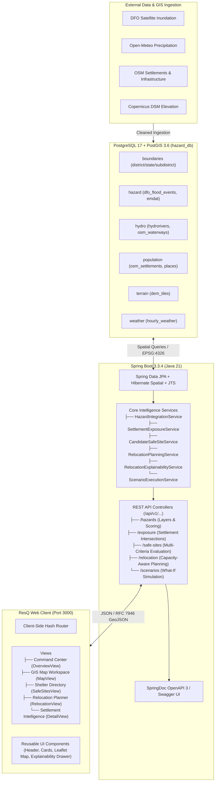

# ResQ — Geospatial Disaster Intelligence & Response Platform

**ResQ** is a geospatial disaster intelligence and decision-support platform designed for emergency planners, disaster management authorities, and district response teams. It ingests multi-source hazard observations, performs spatial risk modeling, identifies candidate safe sites/shelters, and computes capacity-aware, mathematically explainable population relocation plans during flood and extreme rainfall emergencies.

> **Operational Notice:** ResQ functions as an analytical decision-support and scenario-modeling platform. All relocation recommendations and suitability classifications provide mathematically transparent guidance and are intended to assist—not replace—statutory disaster management authorities.

---

## Table of Contents

1. [Project Overview & Purpose](#project-overview--purpose)
2. [Implemented Features](#implemented-features)
3. [Technology Stack](#technology-stack)
4. [System Architecture](#system-architecture)
5. [Prerequisites & Environment](#prerequisites--environment)
6. [Local Setup & Run Commands](#local-setup--run-commands)
7. [Database Configuration & Environment Variables](#database-configuration--environment-variables)
8. [API Endpoints & Documentation](#api-endpoints--documentation)
9. [Testing Instructions](#testing-instructions)
10. [Author & Repository Information](#author--repository-information)

---

## Project Overview & Purpose

During acute disaster events such as seasonal floods and extreme rainfall, response teams face critical coordination challenges:
* **Fragmented spatial visibility:** Siloed hazard data makes it difficult to assess how inundation buffers intersect residential habitations.
* **Shelter overcrowding and capacity bottlenecks:** Evacuation without real-time capacity and headroom accounting leads to overwhelmed facilities or displaced populations sent to inundated areas.
* **Lack of transparency (Black-box decisions):** Emergency personnel cannot easily trace why specific communities were prioritized or assigned to distant facilities.

ResQ addresses these operational gaps by answering core emergency questions deterministically:
1. **Where is the hazard?** Multi-source flood inundation polygons and rolling precipitation time-series.
2. **Who is vulnerable and exposed?** Spatial intersection of residential settlements and population clusters against active hazard buffers.
3. **Which candidate facilities are safe?** Multi-criteria spatial screening across seven distinct environmental and logistical dimensions.
4. **Where should vulnerable populations go?** Capacity-aware shelter allocation balancing total carrying capacity, existing occupancy, and safe headroom.
5. **Who moves first, and why?** Urgency-tiered prioritization with mathematical factor breakdowns and human-readable decision narratives.
6. **What if the situation escalates?** Interactive What-If simulation modeling rainfall surges and demographic shifts.

---

## Implemented Features

### 1. Multi-Hazard Intelligence & Ingestion
* **Multi-Source Ingestion:** Ingests satellite flood inundation records (Dartmouth Flood Observatory) and hourly meteorological precipitation time-series (Open-Meteo API).
* **Spatial Geoprocessing:** Executes PostGIS spatial operations (`ST_Contains`, `ST_DWithin`, `ST_Intersects`) in EPSG:4326.
* **Indicator Normalization:** Applies Min-Max scaling across physical indicators to provide standardized `[0.0000, 1.0000]` comparative metrics.
* **GeoJSON Generation:** Delivers RFC 7946 compliant GeoJSON FeatureCollections for choropleths, hazard polygons, and point infrastructure.

### 2. Settlement Exposure & Vulnerability Profiling
* **Spatial Intersection Analysis:** Computes spatial overlaps between populated places and disaster hazard zones.
* **Vulnerability Scoring:** Computes exposure scores using weighted multi-criteria models.
* **Exposure Classification:** Categorizes affected settlements into priority tiers (`CRITICAL`, `HIGH`, `MODERATE`, `LOW`).

### 3. Multi-Criteria Safe Site Intelligence
* **7-Factor Spatial Screening:** Evaluates candidate evacuation facilities (schools, administrative offices, hospitals, dedicated relief centers) across seven spatial criteria:
  1. *Hazard Safety:* Clearance buffer outside active inundation zones.
  2. *Terrain Stability:* Elevation and slope feasibility analysis.
  3. *Geographic Distance:* Geodesic transit distance to impact zone.
  4. *Road Accessibility:* Proximity to arterial road networks.
  5. *Healthcare Access:* Proximity to operational medical units and hospitals.
  6. *Potable Water Supply:* Proximity to dedicated water assets (excluding flood-contaminated open canals).
  7. *Supporting Infrastructure:* Direct logistical amenities and institutional facilities.
* **Data Integrity:** Unknown shelter capacity is preserved as `null` to avoid fabricating artificial capacity figures.

### 4. Capacity-Aware Relocation Engine
* **Headroom Accounting:** Tracks facility maximum capacity, current occupancy, and remaining safe headroom.
* **Deficit Reporting:** Transparently surfaces shelter deficits whenever regional evacuee volume exceeds safe capacity.
* **Multi-Site Allocation:** Distributes larger displaced populations across ranked candidate shelters without exceeding safe limits.

### 5. Priority & Explainability Engine
* **Deterministic Urgency Tiers:** Categorizes evacuation urgency into `IMMEDIATE`, `SHORT_TERM`, `MEDIUM_TERM`, and `MONITORING`.
* **Auditable Decisions:** Explains *WHO*, *WHERE*, and *WHY* with mathematical weight contributions and natural-language summaries.

### 6. Interactive GIS Command Center Dashboard
* **Modular Frontend Architecture:** Built with Vanilla JavaScript (ES2022 Modules) with zero external JavaScript bundlers.
* **Leaflet Spatial Mapping:** Interactive map interface rendering multi-hazard layers, settlement pins, shelter locations, and transit paths.
* **Environment-Aware Demo Fallbacks:** Clear visual notifications when local demo fixtures are active versus live PostgreSQL backend records.

### 7. What-If Disaster Simulation
* Interactive scenario modeling allowing operators to simulate precipitation spikes (+10% to +60%), hazard intensity surges, and population movements, computing differential impacts in real time.

---

## Technology Stack

| Layer | Technologies |
|---|---|
| **Backend Framework** | Java 21, Spring Boot 3.3.4, Spring Web MVC, Spring Data JPA |
| **Spatial Engine** | Hibernate Spatial 6.5.3, JTS Topology Suite 1.19.0 |
| **Database** | PostgreSQL 17 with PostGIS 3.6 Extension |
| **Connection Pooling** | HikariCP (`HazardHikariCP`) |
| **API Documentation** | SpringDoc OpenAPI 3, Swagger UI, Spring Boot Actuator |
| **Frontend Core** | Vanilla JavaScript (ES2022 Modules), HTML5 Semantic Structure |
| **Styling** | Vanilla CSS3 with Custom Properties (Dark institutional theme) |
| **Geospatial Mapping** | Leaflet.js 1.9.4, RFC 7946 GeoJSON vector layers |
| **Testing** | JUnit 5, Spring Boot Starter Test, MockMvc, AssertJ, Hamcrest, Node.js Test Runner |

---

## System Architecture



---

## Prerequisites & Environment

Ensure the following tools are installed on your local machine:
* **Java Development Kit (JDK):** Version 21 (`java -version`)
* **Apache Maven:** Version 3.9+ (`mvn -version`)
* **PostgreSQL:** Version 16 or 17 with PostGIS 3.6+ extension (`psql -V`)
* **Node.js:** Version 18+ (used for the frontend test runner)
* **Python 3:** Version 3.10+ (used by the launcher to serve static frontend files on port 3000)
* **cURL & Git**

---

## Local Setup & Run Commands

### 1. Clone the Repository
```bash
git clone https://github.com/namandeeptripathi/ResQ.git
cd ResQ
```

### 2. Configure Database & PostGIS
Create the database and enable the PostGIS extension:
```bash
createdb hazard_db
psql -d hazard_db -c "CREATE EXTENSION IF NOT EXISTS postgis;"
```

### 3. One-Command Launch (Recommended)
ResQ provides a unified shell script that verifies PostgreSQL, starts the Spring Boot backend on port `8080`, and serves the frontend on port `3000`:
```bash
./start.sh
```
Or use the npm script shortcut:
```bash
npm start
```
*Note: Press `Ctrl+C` to gracefully terminate all running services.*

### 4. Running Services Individually

**Backend Server (Port 8080):**
```bash
cd backend
mvn spring-boot:run
```

**Frontend Server (Port 3000):**
```bash
cd frontend
python3 -m http.server 3000
```
Then navigate to `http://localhost:3000` in your browser.

---

## Database Configuration & Environment Variables

The backend configuration is managed in [`backend/src/main/resources/application.yml`](backend/src/main/resources/application.yml). The following environment variables can be customized:

| Variable | Default Value | Description |
|---|---|---|
| `PORT` | `8080` | Spring Boot HTTP web server port |
| `DB_HOST` | `localhost` | PostgreSQL host address |
| `DB_PORT` | `5432` | PostgreSQL database port |
| `DB_NAME` | `hazard_db` | Target PostgreSQL database name |
| `DB_USERNAME` | `apple` | PostgreSQL database username (configured default in application.yml) |
| `DB_PASSWORD` | *(empty)* | Database role password |
| `DB_POOL_MAX` | `10` | HikariCP maximum connection pool size |
| `DB_POOL_MIN` | `2` | HikariCP minimum idle connections |

### Database Schemas in `hazard_db`
* **`boundaries`:** Administrative boundaries (`district_boundaries`, `state_boundaries`, `subdistrict_boundaries`).
* **`hazard`:** Disaster event vectors and impact records (`dfo_flood_events`, `emdat_flood_records`).
* **`hydro`:** River network vectors and drainage features (`hydrorivers`, `osm_waterways`).
* **`population`:** Settlement clusters, habitations, and census records (`osm_settlements`, `populated_places`).
* **`terrain`:** Digital elevation raster tile metadata (`dem_tiles`).
* **`weather`:** Hourly precipitation, temperature, and atmospheric time-series records (`hourly_weather`).

---

## API Endpoints & Documentation

Interactive API documentation and schema explorers are accessible when the backend is running:

* **Swagger UI Documentation:** [http://localhost:8080/swagger-ui/index.html](http://localhost:8080/swagger-ui/index.html)
* **OpenAPI 3 JSON Specification:** [http://localhost:8080/v3/api-docs](http://localhost:8080/v3/api-docs)
* **Actuator Health Endpoint:** [http://localhost:8080/actuator/health](http://localhost:8080/actuator/health)
* **Hazard Subsystem Health:** [http://localhost:8080/api/v1/hazards/health](http://localhost:8080/api/v1/hazards/health)

### Primary REST API Endpoints

| Method | Endpoint | Description |
|---|---|---|
| `GET` | `/api/v1/hazards/health` | Subsystem health, PostGIS version, and database status |
| `GET` | `/api/v1/hazards/layers/{layerId}` | RFC 7946 GeoJSON feature layer for map rendering |
| `GET` | `/api/v1/exposure/settlements/district/{district}` | Populated settlements intersecting hazard zones |
| `GET` | `/api/v1/safe-sites?district={district}` | Evaluated and ranked candidate safe shelters |
| `GET` | `/api/v1/relocation/decision?districts={districts}` | Consolidated relocation decisions answering WHO, WHERE, and WHY |
| `POST`| `/api/v1/relocation/plan` | Computes capacity-aware relocation plan with deficit accounting |
| `GET` | `/api/v1/scenarios` | Predefined What-If baseline and perturbation scenarios |
| `POST`| `/api/v1/scenarios/{id}/compare` | Differential before/after impact scenario calculation |

---

## Testing Instructions

### Frontend Tests
The frontend test suite validates routing, API clients, view rendering, capacity calculations, and explainability parsing using Node.js:
```bash
npm test
```
Or directly from the frontend directory:
```bash
cd frontend && npm test
```

### Backend Tests
The Spring Boot test suite validates spatial calculations, relocation planning, explainability generation, and database interactions using JUnit 5 and MockMvc:
```bash
cd backend
mvn test
```

**Run Targeted Test Suite (e.g. OpenAPI / Controller Integration):**
```bash
cd backend
mvn test -Dtest=HazardOpenApiTests
```

---

## Author & Repository Information

* **Platform:** ResQ — Geospatial Disaster Intelligence & Response Platform
* **Author:** [Namandeep Tripathi](https://github.com/namandeeptripathi)
* **Repository:** [https://github.com/namandeeptripathi/ResQ](https://github.com/namandeeptripathi/ResQ)
